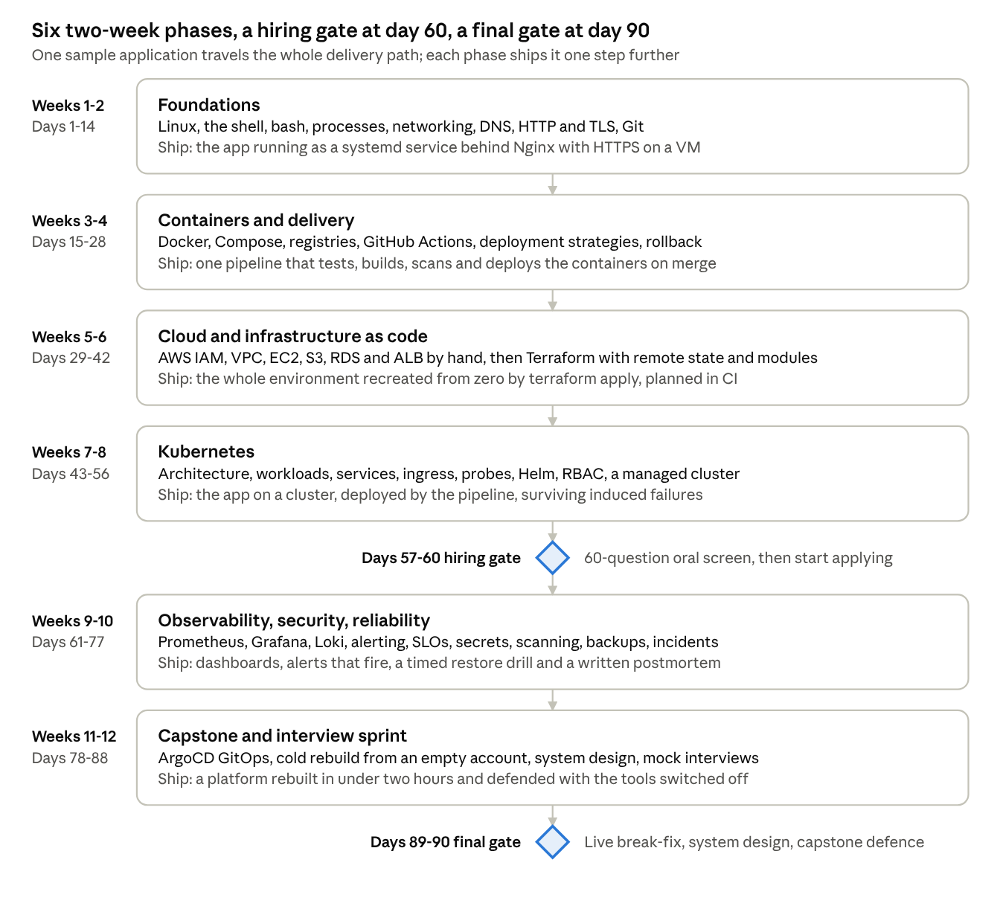

# Zero to DevOps: The 90 Day Fast Track

Nov 8, 2026 · @Israel Iyonsi

A 90-day programme that takes a complete beginner to an intermediate DevOps engineer: able to pass a technical screen by day 60 and to build, run and defend a production platform by day 90. Every topic is taught as what it is, why it exists and how it breaks, because that is what short interview questions test.

## Who it is for and what it promises

The programme takes someone with no engineering background and makes them employable as a junior-to-intermediate DevOps engineer in 90 days, with a hiring gate at day 60.

|  |  |
| --- | --- |
| Entry profile | Comfortable using a computer. No coding, no Linux, no cloud. A laptop with 16 GB RAM (8 GB is workable until the Kubernetes weeks, when the cluster can run on a cloud VM) and a stable connection. |
| Time | About 25 hours a week across 12 teaching weeks and two gate windows: four lesson days, one project day, weekend catch-up. Roughly 300 hours in total. |
| Day 60 outcome | Can explain and operate the full delivery path: Linux, networking, Git, Docker, CI/CD, AWS, Terraform and Kubernetes. Passes a 60-question oral screen and starts applying for jobs. |
| Day 90 outcome | Has built a complete platform from an empty cloud account with observability, secrets management, backups and GitOps, has run an incident on it, and can defend every decision in a mock interview with the tools switched off. |
| What they are not | Not a senior. Not certified. Not fluent in every tool. They understand the problems each tool solves, which is what gets them through the door; depth comes on the job. |

The bet behind the 60-day target comes from Israel's own interviews on both sides of the table: most screens ask short what-and-why questions to gauge depth, and a candidate who truly understands the introductory layer of each topic clears them. The remaining 30 days turn that candidate into someone who survives the first month on the job.

## How every topic is taught: what, why, how it breaks

Every lesson answers three questions in this order, and the Friday drill tests them in this order.

| Question | What the student must be able to do | Why interviewers test it |
| --- | --- | --- |
| What is it? | Define it in two sentences without a tool name, then name the tool. "A container is an isolated process with its own filesystem view; Docker is how we build and run them." | A definition that leans on a tool name hides whether the person understands the thing. |
| Why does it exist? | Name the problem it was invented to solve and what people did before. "Before Terraform, environments were clicked together and drifted; nobody could rebuild staging." | The why is what separates someone who followed a tutorial from someone who can choose between options. |
| How does it break? | Name two real failure modes and the first command they would run. "CrashLoopBackOff: I read the previous container's logs and the events on the pod." | A named failure mode and a first move signal hands-on time, even when it is short. |

Three rules follow from this.

1. One running system, all twelve weeks. Students are handed a small sample application (an API, a worker and a Postgres database) and never change its logic; they may break a test or flip a fault toggle. Each week the same app moves one step further down the delivery path: a server, a container, a pipeline, a cloud account, Terraform, a cluster, dashboards, secrets, GitOps. By day 90 the whole path is theirs and every part of it is an interview story.
2. Breadth of mental model first, depth where interviews probe. Linux, networking, Docker, CI/CD, Kubernetes, Terraform and one cloud get real depth. Everything else (Ansible, service meshes, multi-cloud, platform engineering) gets a lesson that explains what problem it solves and where it sits, so the student can place it in a conversation without claiming fluency.
3. Break it on purpose every week. A tool is understood when the student has watched it fail. Each project ends with induced failures the student must diagnose from logs and errors only, and write up in a debug log. Those logs become their behavioural interview answers.

## Programme at a glance

Weeks 1 to 8 are the job-ready floor. A student who clears the day-60 gate applies for roles while weeks 9 to 12 add the operational depth that makes the first month on the job survivable.

## Weekly rhythm and the AI licence

A week has four lesson days, one project day and an oral drill, and the same shape every week so the student spends energy on content, not logistics.

| Day | What happens | Hours |
| --- | --- | --- |
| Monday to Thursday | One lesson a day: a 40-minute concept session (what, why, how it breaks), then a 3-hour lab on the sample app. Each lab ends with a short written note in the student's own words. | 4 each |
| Friday | Project day. The week's brief lists acceptance criteria; the student builds until every box is ticked, then runs the induced failures and writes the debug log. | 6 |
| Friday, last hour | The oral drill. Fifteen short questions from the week's bank, 60 seconds each, editor closed. Fewer than twelve clean answers means the missed labs are redone at the weekend and re-drilled on Monday morning; two misses in a row move the student to the next cohort. | 1 |
| Weekend | Catch-up, the ai-log, the one-page summary of the week that becomes revision material for the gates, and in weeks 2 to 6 a two-hour Python exercise: a log parser, an HTTP health checker, a YAML validator, then a boto3 script that lists untagged resources. | 2 to 4 |

The AI licence states how much a student may delegate, and it is printed on every weekly brief and enforced in review. For DevOps it matters more than for application code: generated Terraform and Kubernetes manifests look finished and fail in ways a beginner cannot see.

| Weeks | Licence | What AI may do | The check |
| --- | --- | --- | --- |
| 1 to 4 | Red | Explain, quiz, review commands the student already ran. It never writes a Dockerfile, a workflow or a script for them. | Can you retype the file from an empty editor? |
| 5 to 8 | Yellow | Scaffold boilerplate (provider blocks, manifest skeletons, workflow syntax). The student writes the resources, the logic and every decision. | A random line is picked in review. One "I don't know" returns the work. |
| 9 to 12 | Green | Implement from a written spec. The student reviews line by line, owns the result, and must explain any line on demand. | "The AI wrote it" is not an explanation, in review or in a postmortem. |
| Gates | Off | Nothing. Oral screens, break-fix and the defence run with no AI and no internet beyond the cluster. | The interview runs with the tools off, so the gate does too. |

Every student keeps an ai-log.md: what was delegated, what came back, what they changed and why. It is read in review.

## Week 1: Linux and the shell (days 1 to 7, Red licence)

By Friday the sample app runs on a Linux server the student set up, survives a reboot, and backs itself up at night. Every server, container and pipeline runner they meet later runs on what this week teaches.

| Day | Lesson | What and why | How it breaks |
| --- | --- | --- | --- |
| Mon | What an operating system does for a program | Processes, memory, files, users and permissions as the four things every program needs. ssh, the shell, man pages, sudo, creating users. The AWS account is opened today too: root user MFA, a budget alarm, an admin user; the Free plan credits start counting from here. | Running everything as root; a locked-out server after a bad sshd change. |
| Tue | Files, permissions and packages | Where things live (/etc, /var, /opt, /home), chmod and chown, apt, where logs are written. | 600 versus 755 on a key; a service that cannot read its own config. |
| Wed | Processes and services | ps, top, signals, systemd units, journalctl, ports and sockets with ss, environment variables. Why a supervisor beats nohup. | A port already in use; a service that starts before the database; SIGTERM ignored. |
| Thu | Text tools and automation | grep, awk, sed, pipes and redirection, bash scripting with exit codes and set -euo pipefail, cron, then the same log parser written again in Python, which continues as a weekend thread through week 6. | A cron job failing silently for weeks; a script that keeps going after the first error. |

**Project: the app on a server.** Provision a public Ubuntu VM (EC2 on the account's credits, or a small VPS; a local VM is fine for Monday's lab only, because weeks 2 and 4 need a host the internet can reach). Install Postgres and the app runtime, run the API and worker as systemd services under a dedicated service user, write a nightly backup script with rotation and schedule it with cron, allow ssh by key only, and open only ports 22 and 80.

Done when:

- The server reboots and the app comes back without a human.
- Password login over ssh is refused.
- The backup file appears on schedule and restores into an empty database.
- The student explains every line of the unit file and the script.

Induced failures: fill the disk and watch the app fail; kill the database process; break permissions on the app directory; start a second process on the app's port.

| Interview drill | A strong 60-second answer names |
| --- | --- |
| What happens when you type a command and press enter? | Shell parsing, the PATH lookup, fork and exec, stdout and stderr, the exit code. |
| What does chmod 755 mean, and when would you use 600? | Owner read-write-execute, group and others read-execute; 600 for private keys and secrets. |
| How do you find what is using port 8080? | ss -tulpn or lsof -i, then ps on the PID, then the unit that owns it. |
| The server is slow. What are your first three commands? | top or htop for load and CPU, free for memory, df and iostat for disk, then the logs. |
| What is PID 1 and why does it matter in a container? | The init process, signal handling and zombie reaping; in a container the app is often PID 1 and must handle SIGTERM. |
| df says the disk is full but du does not add up. Why? | A deleted file still held open by a process, or inode exhaustion; lsof +L1, then restart or truncate. |
| Why systemd instead of running the binary with nohup? | Supervision, restart policy, boot ordering, dependencies, logging in one place. |
| Why set -euo pipefail at the top of a script? | Stop on error, on an unset variable and on a failure inside a pipe, so cron jobs do not fail silently. |

## Week 2: Networking, Git and how the web works (days 8 to 14, Red)

By Friday the app sits behind Nginx on a real domain with a valid certificate, and every config file lives in Git. The question nearly every screen asks, what happens when you type a URL, is answered from experience rather than memory.

| Day | Lesson | What and why | How it breaks |
| --- | --- | --- | --- |
| Mon | The request path | IP addresses, ports, TCP versus UDP, DNS resolution and the TLS handshake at overview depth, an HTTP request and response. OSI as vocabulary, not doctrine. dig, curl -v, traceroute, tcpdump. | A DNS record cached by TTL; a firewall dropping packets with no error. |
| Tue | Networks and boundaries | Private versus public addresses, CIDR and subnets, NAT, gateways, firewalls, layer 4 versus layer 7 load balancers, reverse proxies. Nginx in front of the app. | 502 versus 504; a proxy header lost so the app sees the wrong client IP. |
| Wed | DNS and TLS properly | Record types, TTL, zone apex limits, certificates, chains and authorities, Let's Encrypt, redirects, HSTS. certbot and openssl s\_client. | An expired certificate on a Saturday; a CNAME at the apex; mixed content. |
| Thu | Git for people who ship | Commits, branches, merge versus rebase, conflicts, pull requests and review, trunk-based versus gitflow, tags and semver, never committing secrets, revert versus reset, reflog. | A rebase on a shared branch; a secret pushed to a public repo. |

**Project: a real domain with HTTPS.** Nginx reverse proxy in front of the API, a domain (or free subdomain) pointing at the VM, a Let's Encrypt certificate with automatic renewal, HTTP redirected to HTTPS, firewall limited to 22, 80 and 443, all configs committed with a README that draws the request path from browser to database.

Done when:

- The site scores A on SSL Labs or passes testssl.sh clean.
- curl to the HTTP address returns a 301 to HTTPS.
- A renewal dry run succeeds.
- The student draws the request path on a whiteboard, unaided, and names where each failure from this week would show up.

Induced failures: swap in a staging certificate and watch browsers refuse it; stop the API and read the 502; change DNS with a long TTL and wait; a rebase that conflicts.

| Interview drill | A strong 60-second answer names |
| --- | --- |
| What happens when you type a URL into a browser? | DNS, TCP handshake, TLS, HTTP request, server processing, response, render, in order and with the layers named. |
| What is the difference between a 502 and a 504? | Upstream refused or returned garbage versus upstream did not answer in time. |
| What is a CNAME, and where can you not use one? | An alias that cannot coexist with other records, so never at the zone apex, which must hold SOA and NS; providers offer alias records (Route 53 alias) for that case. |
| Layer 4 versus layer 7 load balancer? | TCP connection balancing versus HTTP-aware routing on paths and headers with TLS termination. |
| How does TLS establish trust? | A key exchange in the hello messages, then the server proves its identity with a certificate whose chain leads to a root in the client's trust store, whose name matches the host, and which is in date. |
| Public versus private IP, and what does NAT do? | RFC 1918 ranges; NAT rewrites private sources to a public address for outbound traffic. |
| Merge versus rebase, and when would you never rebase? | A merge commit that keeps history as it happened versus a rewritten linear history; never rewrite a branch others have pulled. |
| You pushed a secret to GitHub. What do you do? | Rotate the secret first, then purge the history, then find out how it got there. |

## Week 3: Containers with Docker (days 15 to 21, Red)

By Friday the whole stack starts with one command on any machine, the images are small, run as non-root and carry no critical vulnerabilities, and the student can say what a container actually is without using the word Docker.

| Day | Lesson | What and why | How it breaks |
| --- | --- | --- | --- |
| Mon | What a container is | An isolated process: namespaces, cgroups, a layered filesystem. Container versus virtual machine, image versus container, registries and tags. | "Works on my machine" because the image was never rebuilt; a tag that silently moved. |
| Tue | Building images well | Dockerfile instructions, layer caching and ordering, multi-stage builds, small base images, non-root users, .dockerignore, CMD versus ENTRYPOINT, COPY versus ADD, digests. | A 1.2 GB image with the compiler inside; cache busted by copying source before dependencies. |
| Wed | Running containers | Volumes versus bind mounts, user-defined networks and DNS by service name, environment and config, ports, health checks, restart policies, memory and CPU limits. | Exit code 137; data lost on down; the app connecting to localhost instead of the database service. |
| Thu | Compose and debugging | Compose files, dependency ordering gated on health checks, profiles, a container that exits at once, image scanning with Trivy. | The API starting before Postgres is ready; a critical CVE in the base image. |

**Project: the app in containers.** Multi-stage, non-root images for the API and worker, a Compose stack with Nginx, API, worker and Postgres, health checks on every service, images pushed to a registry tagged with the Git SHA, a Trivy report with no critical findings, a one-command cold start documented in the README.

Done when:

- docker compose up on a clean machine works first time.
- The API image is under the size target set in the brief for the chosen stack (about 100 MB for Go, about 200 MB for .NET or Node slim images).
- Every process runs as a non-root user.
- Data survives a down and up.
- The student explains each line of each Dockerfile and why it is in that order.

Induced failures: a memory limit that kills the worker; the API started before the database; a wrong volume path that loses data; a port conflict; a file missing from the image because of .dockerignore.

| Interview drill | A strong 60-second answer names |
| --- | --- |
| Image versus container? | A read-only stack of layers versus a running instance with a writable layer on top. |
| Container versus virtual machine? | Shared kernel with namespaces and cgroups versus a hypervisor and a full guest OS. |
| Why multi-stage builds? | Build tools stay out of the runtime image: smaller, faster to pull, less to attack. |
| CMD versus ENTRYPOINT? | Default arguments versus the executable; how they combine when both are set. |
| Why does the order of Dockerfile lines matter? | Layer cache invalidation: copy dependency manifests before source so installs are cached. |
| A container exits immediately. How do you debug it? | docker logs, the exit code, override the entrypoint with a shell, check the command and config. |
| How do two containers talk to each other? | A user-defined network with DNS by service name; never localhost. |
| Why not run as root inside a container? | Blast radius if the container is escaped, host file ownership, and most policies forbid it. |

## Week 4: CI/CD with GitHub Actions (days 22 to 28, Red)

By Friday a merge to main reaches the live server with no human in the loop, a bad test blocks the merge, and a rollback has been practised and timed. "Walk me through your pipeline" becomes a two-minute story with a diagram.

| Day | Lesson | What and why | How it breaks |
| --- | --- | --- | --- |
| Mon | What CI/CD is and why | Integration pain and the feedback loop, CI versus CD versus continuous deployment, pipeline stages, build once and deploy many, artifacts and versioning. | Builds that pass locally and fail in CI; a release built differently for each environment. |
| Tue | GitHub Actions mechanics | Triggers, jobs, steps, runners, matrix, caching, artifacts, secrets, OIDC to the cloud as a concept that week 6 puts to work, environments with required reviewers, concurrency, reusable workflows. | A secret printed to the log; a cache serving stale dependencies; a workflow with write-all permissions. |
| Wed | Deploying | Recreate, rolling, blue-green and canary explained with drawings; rollback by redeploying a previous immutable tag; migrations in the pipeline; smoke tests; tags and release notes. | A deploy that succeeds while the app is broken; a migration that cannot be rolled back. |
| Thu | Pipeline quality | Flaky tests, duration budgets, pinning actions by SHA, least-privilege tokens, protected branches, a team's branching rules. What Jenkins, GitLab CI and Azure Pipelines share with Actions. | A retried-until-green test hiding a real bug; a third-party action compromised under a moving tag, as tj-actions/changed-files was in March 2025. |

**Project: merge means deployed.** Pull requests run lint, tests, image build and a Trivy scan as required checks. Merge to main pushes SHA-tagged images, deploys to the VM over SSH with a dedicated, command-restricted deploy key, runs a smoke test against the health endpoint and notifies. A separate rollback workflow takes a SHA as input. A production environment requires one approval. The pipeline finishes in under ten minutes.

Done when:

- A deliberately failing test blocks the merge.
- A merge reaches the live URL with no manual step.
- A rollback to the previous SHA is practised and timed.
- The deploy key is restricted to the deploy command, and the student can say why an OIDC-assumed role replaces it in week 6.
- The student draws the pipeline from commit to running process.

Induced failures: a secret missing from the environment; a stale cache; a deploy that passes while the app returns 500 (the smoke test must catch it); a flaky test; an expired token.

| Interview drill | A strong 60-second answer names |
| --- | --- |
| CI versus CD versus continuous deployment? | Integrate on every change; always releasable; every change released automatically. |
| Walk me through your pipeline. | Triggers, stages, gates, how the artifact is versioned, how it deploys, how it rolls back. |
| How do you keep secrets out of pipelines and logs? | A secrets store, masking, short-lived credentials through OIDC, never echo a secret. |
| Why build once and deploy many? | The same artifact is promoted; no environment-specific rebuilds; traceability from SHA to production. |
| How do you roll back? | Redeploy the previous immutable tag; the database migration is the hard part, so changes are backward compatible. |
| Blue-green versus canary? | Full swap with instant rollback versus a traffic percentage gated on metrics. |
| What is a flaky test and what do you do about it? | Non-deterministic; quarantine, find the root cause, never retry forever. |
| Where do database migrations run and what goes wrong? | Before or alongside the deploy; expand and contract so old and new code both work. |

## Week 5: Cloud fundamentals on AWS (days 29 to 35, Yellow opens)

By Friday the app runs on AWS in the shape a real team would use: a load balancer in public subnets, compute and database in private subnets, roles instead of keys, alarms and a budget. It is built by hand on purpose so that Terraform next week replaces something the student understands. AWS is the primary cloud because it dominates job adverts; each lesson names the Azure equivalent so the student can hold either conversation.

| Day | Lesson | What and why | How it breaks |
| --- | --- | --- | --- |
| Mon | The account and identity | Shared responsibility, regions and availability zones, the Free plan (accounts opened after July 2025 get up to 200 USD of credits over six months, then must upgrade to Paid). IAM users, groups, roles and policies; how a request is evaluated (explicit deny beats allow, identity versus resource policies, trust versus permission policies, AssumeRole); least privilege; why servers get roles and never keys; CloudTrail as the record of who did what. (Azure: subscriptions, resource groups, Entra ID, managed identities.) | Access keys in a repo; a wildcard policy nobody reviews; a surprise bill. |
| Tue | Network in the cloud | VPC, public and private subnets, route tables, internet gateway, NAT gateway, security groups versus NACLs, VPC endpoints (an S3 gateway endpoint removes NAT charges), peering versus Transit Gateway in one line, Session Manager instead of a bastion. (Azure: VNet, NSG, NAT Gateway, Bastion.) | A private instance that cannot reach the internet; a health check blocked by a security group. |
| Wed | Compute, storage, database | EC2 instance types, AMIs, user data and instance roles; S3 buckets, policies, versioning, lifecycle and storage classes; RDS Postgres with Multi-AZ, backups and parameter groups; ALB, target groups and health checks. (Azure: VM, Blob, Azure Database for PostgreSQL, Application Gateway.) | A public bucket; a database in the wrong subnet group; a target group with no healthy targets. |
| Thu | Operating and paying | CloudWatch metrics, logs and alarms; what costs money (NAT hours and data, egress, idle volumes and addresses); tagging; managed versus self-hosted trade-offs; a cost report script in Python with boto3. | A NAT gateway left running; a resource with no tag and no owner. |

**Project: the app on AWS, by hand.** Build the target topology in the console, drawn before it is built; Terraform rebuilds it next week: ALB in public subnets, EC2 in private subnets with no public IP and access only through Session Manager, RDS Postgres private, backups to S3 through an instance role, CloudWatch alarms on CPU and 5xx, a budget alarm. Every manual step is logged, because next week's Terraform must cover all of them.

Done when:

- The app answers through the ALB DNS name.
- The database is unreachable from the internet, proved with a scan from outside.
- No access keys exist on the instance.
- Monthly cost is estimated and under the budget in the brief.
- Everything is torn down and the next bill shows zero residual charges.

Induced failures: a security group blocking the health check; a route table without the NAT route; an IAM policy denying the S3 write; RDS in the wrong subnet group; a NAT gateway forgotten overnight.

| Interview drill | A strong 60-second answer names |
| --- | --- |
| Public versus private subnet? | A route to an internet gateway versus none; private egress through NAT. |
| Security group versus NACL? | Stateful, instance-level, allow-only versus stateless, subnet-level, allow and deny. |
| IAM role versus IAM user, and why roles for servers? | Short-lived credentials delivered and rotated by the platform, fetched through IMDSv2 so a server-side request forgery cannot steal them. |
| How would you host a web app with a database on AWS? | ALB, compute in private subnets across two zones, RDS Multi-AZ, S3, roles, CloudWatch, a budget. |
| What is the shared responsibility model? | AWS secures the cloud; the customer secures what they put in it: identity, data, configuration. |
| What costs money that beginners forget? | NAT gateway hours and data, data transfer out, every public IPv4 address at 0.005 USD an hour, idle volumes, snapshots. |
| A user has an allow policy but still gets access denied. Why? | An explicit deny somewhere wins: a resource policy, a permission boundary or an organisation SCP; CloudTrail shows which call failed. |
| How do you reach a private instance without a bastion? | Session Manager through the instance role; no inbound port 22 at all. |

## Week 6: Infrastructure as code with Terraform (days 36 to 42, Yellow)

By Friday everything built by hand last week is destroyed and recreated by terraform apply with no console steps, and the pipeline plans infrastructure changes on every pull request. The student can explain state to a non-engineer, which is the question that separates people who have used Terraform from people who have watched it.

| Day | Lesson | What and why | How it breaks |
| --- | --- | --- | --- |
| Mon | Why infrastructure as code | Drift, repeatability, review and disaster recovery as the problems; declarative versus imperative; providers, resources, data sources; init, plan, apply, destroy; the state file as the map between code and reality. | Two people applying at once; state deleted; a plan nobody read. |
| Tue | State and structure | Remote state in S3 with native locking (use\_lockfile, Terraform 1.10 and later; DynamoDB locking is the legacy they will still meet), never editing state by hand, moved and import blocks, replace, variables, outputs, locals, modules, naming and tagging conventions. | A stuck lock; a renamed resource that plans a destroy and recreate of the database. |
| Wed | Environments and pipelines | Dev and prod through separate roots and tfvars, separate state per environment, secrets kept out of code and state, plan on pull request and apply on merge with approval, both jobs assuming a role through OIDC, fmt, validate, tflint and Checkov. | A secret in plan output; prod applied from a laptop; a provider upgrade that changes behaviour. |
| Thu | The rest of the landscape | Configuration management versus provisioning, with Ansible as a one-hour concept and a weekend exercise; CloudFormation, Bicep, Pulumi and CDK in a sentence each; OpenTofu and why it exists (the BSL licence change, then IBM's purchase of HashiCorp). | Ansible run against the wrong inventory; mixing mutable configuration with immutable infrastructure. |

**Project: destroy it and bring it back.** Last week's environment destroyed by hand, then recreated from Terraform alone: network, compute and database modules, remote state with locking, dev and prod roots, plan posted to the pull request, apply on approval through an OIDC-assumed role, Checkov clean.

Done when:

- terraform destroy then apply yields a working app with no console step.
- A change made in the console shows up as drift on the next plan.
- A reviewer can read the plan on a pull request and say what will change, and no long-lived cloud key exists in repository secrets.
- The student explains what state is, and why it is remote and locked, to someone non-technical.

Induced failures: a stuck state lock; a security group edited in the console; a rename that would replace the database (the plan must be read, not applied); a provider version bump; a secret appearing in plan output.

| Interview drill | A strong 60-second answer names |
| --- | --- |
| What is Terraform state and why keep it remote with locking? | The mapping from code to real resources; one shared truth; concurrent applies corrupt it. |
| What does terraform plan show and what do you look for? | Create, update, replace and destroy; a replace on anything stateful is the red flag. |
| Someone changed a resource in the console. What happens? | Drift; the next plan shows the difference; apply to revert it, or change the code to match (ignore\_changes if it is legitimately external); then fix the access that allowed it. |
| Declarative versus imperative? | Desired end state versus steps to get there; idempotence falls out of the first. |
| How do you structure Terraform for dev and prod? | Shared modules, one root per environment, separate state, the same code with different variables. |
| Terraform versus Ansible? | Provisioning infrastructure versus configuring what runs on it; immutable images shrink the second job. |
| How do you handle secrets in Terraform? | Never in code; let the service own it (RDS can manage its master password) or use ephemeral resources and write-only arguments so it never lands in state; state is sensitive anyway, so encrypt and restrict it. |
| What is a module and when do you write one? | A reusable unit with inputs and outputs; when the same shape appears a second time. |

## Week 7: Kubernetes core (days 43 to 49, Yellow)

By Friday the app runs on a local cluster with probes, limits, an ingress and autoscaling, has survived a rolling update under load, and the student has fixed five induced failures using nothing but kubectl output. Kubernetes is where most intermediate interviews spend their time, so this week and the next get the deepest treatment.

| Day | Lesson | What and why | How it breaks |
| --- | --- | --- | --- |
| Mon | Why orchestration, and the architecture | What a VM and Compose cannot do: scheduling, self-healing, scaling, rolling updates, discovery. Control plane (API server, etcd, scheduler, controller manager) and nodes (kubelet, kube-proxy, containerd through the CRI, the CNI that gives pods addresses, CoreDNS). Why Kubernetes no longer uses Docker. What happens when you kubectl apply. A kind cluster. | A control plane that is fine while every pod is broken, and vice versa. |
| Tue | Workloads | Pods, ReplicaSets, Deployments, labels and selectors, namespaces, rolling updates and rollbacks, Jobs and CronJobs (the backup moves here). | A selector that matches nothing; a rollout stuck at one unavailable replica. |
| Wed | Networking and configuration | Services (ClusterIP, NodePort, LoadBalancer), cluster DNS, Ingress (frozen but everywhere) and Gateway API (GatewayClass, Gateway, HTTPRoute) as its successor, with Envoy Gateway or Traefik on kind, and why the 2026 retirement of ingress-nginx made controller choice an operational risk, ConfigMaps and Secrets and why a Secret is only base64, environment versus mounted files. | A Service pointing at the wrong port; a config change that pods never pick up. |
| Thu | Keeping pods healthy | Liveness, readiness and startup probes, requests and limits, quality of service and eviction, the Horizontal Pod Autoscaler, PodDisruptionBudgets, graceful shutdown (SIGTERM, preStop, terminationGracePeriodSeconds), taints and tolerations, affinity, DaemonSets, a StatefulSet with a PersistentVolumeClaim for the Postgres on kind. Reading CrashLoopBackOff, ImagePullBackOff, Pending and OOMKilled. | A liveness probe that restarts a healthy slow app; limits too low; a pod Pending forever. |

**Project: the app on a cluster.** On a kind cluster: namespaces, Deployments for the API and worker with probes and resource settings, Services, HTTP routing through Gateway API or Ingress with TLS, Postgres as a StatefulSet with a volume, ConfigMap and Secret, a CronJob for backups, an HPA, a rolling update performed under a continuous request loop, and a debug log of five induced failures diagnosed from kubectl describe, logs and events only.

Done when:

- kubectl apply from the repository yields a working app on a fresh cluster.
- A rollout under the request loop shows zero failed requests, which only happens when graceful shutdown is done right.
- Each induced failure has a written diagnosis path: symptom, command, evidence, fix.
- The student explains the apply path from API server to running container.

Induced failures: a wrong image tag; a readiness probe on the wrong path; a memory limit below the app's need; a Service selector typo; a pod requesting more CPU than any node has.

| Interview drill | A strong 60-second answer names |
| --- | --- |
| What happens when you apply a Deployment? | API server authenticates, authorises, runs admission and stores in etcd; the Deployment controller makes a ReplicaSet and the ReplicaSet controller makes pods; the scheduler assigns nodes; kubelet starts containers through containerd and the CNI assigns addresses. |
| Pod versus ReplicaSet versus Deployment? | The unit of scheduling; the desired replica count; the rollout and rollback manager above it. |
| Liveness versus readiness probe? | Restart the container versus remove it from the Service; the wrong choice causes restart loops. |
| What are the Service types and when do you use Ingress? | ClusterIP inside, NodePort for testing, LoadBalancer for a cloud LB; Ingress on existing clusters and Gateway API with HTTPRoute on new ones for HTTP routing. |
| A pod is in CrashLoopBackOff. What do you do? | describe, logs with --previous, events; then the command, probes and config. |
| Requests versus limits? | Scheduling input versus enforcement; CPU is throttled, memory is killed. |
| What happens when a node dies? | About 40 seconds to NotReady, then taint-based eviction after 300 seconds by default; StatefulSet pods are not replaced while the node is unreachable, and a volume tied to one availability zone cannot follow. |
| Are Kubernetes Secrets secure? | Base64 is encoding; add etcd encryption, RBAC and an external secrets manager. |

## Week 8: Kubernetes in production, then the day-60 gate (days 50 to 60, Yellow)

By Friday the app runs on a real cluster in AWS, deployed by the pipeline with short-lived credentials, with access controls a reviewer can verify. Days 57 to 60 are the hiring gate: a student who passes starts applying for jobs that week.

| Day | Lesson | What and why | How it breaks |
| --- | --- | --- | --- |
| Mon | Helm | Why templating, charts, values, releases, upgrade and rollback, chart repositories; Kustomize as the overlay alternative. | A values file for prod applied to dev; a chart upgrade that recreates a volume. |
| Tue | Managed clusters | EKS and AKS versus self-managed; node groups; cluster autoscaling and Karpenter in concept; EKS Pod Identity for new clusters and IAM roles for service accounts for the ones they will inherit; access entries instead of the deprecated aws-auth ConfigMap; cloud load balancers through the AWS Load Balancer Controller; cost, with k3s on one EC2 instance as the budget path. | A control plane bill nobody expected; pods that cannot reach S3 because the node role was used instead of a service account role. |
| Wed | Access and safety | RBAC roles and bindings, service accounts, access entries, namespaces as boundaries, quotas and limit ranges, admission control in concept. Network policies and pod security standards wait for week 10. | A developer with cluster-admin; a network policy on EKS that is accepted and silently does nothing because the VPC CNI policy feature is off. |
| Thu | Deploying from CI, and state | The pipeline assumes a role through OIDC and deploys the chart; StorageClasses on a cloud cluster and why the database stays on RDS for a small team; the EKS Terraform module is handed over as a Yellow-licence scaffold the student reads and extends. Revision for the gate. | A kubeconfig in a repository secret; a StatefulSet that loses its volume on a bad delete. |

**Project: production cluster, pipeline deploy.** The cluster comes from Terraform (EKS, or k3s on EC2 on the budget path). The app is a Helm chart with values per environment. The pipeline deploys on merge using an OIDC-assumed role. A read-only developer is granted through an access entry. The whole thing is destroyed and recreated by Terraform plus the pipeline.

Done when:

- A merge updates the running app on the cluster within ten minutes.
- The read-only user cannot delete a pod, proved with the denied command.
- The cluster's monthly cost is written down before it is created.
- No long-lived kubeconfig or cloud key exists in repository secrets.

**The day-60 gate (days 57 to 60).** AI and internet off except for the cluster itself.

1. A 60-question oral screen drawn from the weeks 1 to 8 banks, 60 seconds a question; 45 clean answers to pass.
2. Whiteboard the path from a commit to a running pod, with every credential and every gate named.
3. A 30-minute break-fix on a cluster the instructor has sabotaged.
4. A CV and LinkedIn profile written from the project log and reviewed, then the first ten applications sent.

Day 61 is an applications day and week 9 starts on the Monday after. A pass means the student applies for roles from day 60 while weeks 9 to 12 continue. A fail means the weakest two weeks are redone in the evenings of week 9 and the gate is retaken seven days later.

| Interview drill | A strong 60-second answer names |
| --- | --- |
| Helm versus plain manifests versus Kustomize? | Templating plus release lifecycle; raw files; overlays without templating; when each fits. |
| Would you run Postgres on Kubernetes? | You can, with an operator; for a small team a managed database wins on backups, failover and operational burden. |
| How does your pipeline authenticate to the cluster? | OIDC to a cloud role, a kubeconfig generated at run time, nothing long-lived stored. |
| How do you give a developer read-only access to one namespace? | A Role or the built-in view ClusterRole bound in that namespace to their identity. |
| How does a pod get AWS permissions without keys on the node? | EKS Pod Identity or IRSA binds a service account to a role; the node role stays minimal; the difference between the two is a common follow-up. |
| How do you upgrade a cluster safely? | Check deprecated APIs, control plane first, node groups rolling with disruption budgets, dev before prod. |
| Managed versus self-managed Kubernetes? | The control plane, upgrades and etcd handled for you, at a monthly cost, versus full control and full burden. |
| A deploy went bad in production. What do you do? | Roll back first with helm rollback or rollout undo, then find out why it was not caught earlier. |

## Week 9: Observability (days 64 to 70, Green opens)

By Friday the student knows the app is unhealthy before a user does: dashboards that answer one question each, two alerts that reach a phone, and a written service level objective with an error budget. This is the week the student stops asking whether it deployed and starts asking whether users are getting errors.

| Day | Lesson | What and why | How it breaks |
| --- | --- | --- | --- |
| Mon | Monitoring versus observability | Metrics, logs and traces as three views of one system; the four golden signals; RED for services and USE for resources; writing down what to measure for the sample app before installing anything. | Dashboards full of CPU graphs while users see errors. |
| Tue | Prometheus and Grafana | The pull model, exporters, labels and cardinality, PromQL for rate and percentiles, kube-prometheus-stack, a dashboard that answers a question. | A label with a user ID in it; a p95 query that is really an average. |
| Wed | Logs and traces | Structured logging, levels, Loki with Grafana Alloy as the log agent (Promtail reached end of life in March 2026), retention and cost, correlation IDs, OpenTelemetry and distributed tracing in concept with one end-to-end trace. | Logs nobody can search; a slow request nobody can place. |
| Thu | Alerting and service levels | Symptom-based alerts, Alertmanager routing, alert fatigue, on-call hygiene, service level indicators and objectives, error budgets, burn-rate alerts, a runbook linked from every alert. | An alert that pages at 3 a.m. for nothing; one that never fires because the query was wrong. |

**Project: know before the users do.** Prometheus, Grafana and Loki on the cluster; a RED dashboard for the API and a saturation dashboard for nodes and pods; two alerts (error rate and p95 latency) routed to a phone; a service level objective document with a 99.5 percent availability target and its error budget; a k6 load test that burns budget and trips an alert; a runbook for each alert.

Done when:

- An induced failure fires an alert within two minutes and the runbook leads to the fix.
- The dashboard answers "is the app healthy right now" in one glance.
- The student explains p95 versus average to a product manager in plain words.

Induced failures: a simulated memory leak; database connection pool exhaustion; a cardinality explosion from a bad label; an alert with a broken PromQL expression.

| Interview drill | A strong 60-second answer names |
| --- | --- |
| Monitoring versus observability? | Watching known failure signals versus being able to ask new questions of the system from its outputs. |
| What are the four golden signals? | Latency, traffic, errors, saturation, and what each looks like for this app. |
| p95 versus average, and why it matters? | Tail latency is what users feel and averages hide it. |
| How does Prometheus collect metrics? | It pulls from scrape targets found by service discovery, through exporters, on an interval. |
| What would you alert on, and what would you not? | Symptoms users feel, tied to a service level; not CPU on its own. |
| What is an SLO and an error budget? | A target on an indicator over a window; the allowed unreliability that sets the release pace. |
| How do you find why one request was slow across services? | A correlation ID in logs and a trace with spans per hop. |
| Logs are expensive. How do you control the cost? | Levels, sampling, retention, structured fields, dropping noise at the collector. |

## Week 10: Security and reliability (days 71 to 77, Green)

By Friday no secret lives in Git or in a ConfigMap, the pipeline refuses a critical vulnerability, a database restore has been timed, and the student has run an incident and written the postmortem. The game day on Thursday produces the story every behavioural interview asks for.

| Day | Lesson | What and why | How it breaks |
| --- | --- | --- | --- |
| Mon | Secrets | Why not Git, environment files or ConfigMaps; AWS Secrets Manager and Parameter Store; the External Secrets Operator; sealed secrets; rotation; what to do in the first five minutes after a leak. | A rotated password the app never picked up; a secret readable by every namespace. |
| Tue | Supply chain and hardening | Trivy for images and infrastructure code, dependency scanning, SBOMs, image signing in concept, pinning versions and actions, an IAM least-privilege review, pod security standards and network policies (on EKS only with the VPC CNI policy feature turned on), TLS everywhere with cert-manager. | A base image with a known critical CVE; a third-party action that changed under a tag. |
| Wed | Reliability | Backups and the restore drill, recovery point and recovery time objectives, high availability versus disaster recovery, Multi-AZ, disruption budgets, graceful shutdown, timeouts and retries. | A backup that was never restored; an app that drops requests on every deploy. |
| Thu | Incidents | Severity levels, the incident commander and communications roles, keeping a timeline, status updates, blameless postmortems, action items with owners, what on-call expects. Game day. | Three people fixing the same thing; a postmortem that blames a person and changes nothing. |

**Project: harden it, break it, restore it.** Every secret moved to Secrets Manager through External Secrets and the database password rotated without downtime; a Trivy gate in CI that fails on critical findings; cert-manager issuing certificates on the ingress; an IAM review with findings fixed; a backup and timed restore against a stated recovery objective; a game day where the instructor breaks three things and the student runs the incident and writes the postmortem within 24 hours.

Done when:

- No secret exists in Git history, a ConfigMap or a plain Kubernetes Secret managed by hand.
- An old base image blocks the pipeline, proved by trying it, and the database answers only to the API pods, proved from another pod.
- The restore completes under 30 minutes with data loss inside the recovery point objective.
- The postmortem follows the template and every action item has an owner and a date.

Game day failures: an expired certificate; a leaked key that must be rotated; the database deleted; a node drained at peak; a network policy that blocks the app.

| Interview drill | A strong 60-second answer names |
| --- | --- |
| How do you manage secrets in Kubernetes properly? | An external secrets manager, an operator that syncs them, RBAC on who can read, rotation. |
| A key leaked on GitHub. What are the first five minutes? | Revoke and rotate, check what it touched, purge the history, then the postmortem. |
| RPO versus RTO? | How much data you can lose versus how long you can be down; backup frequency and replication set the first, restore and failover speed set the second. |
| High availability versus disaster recovery? | Surviving a component failure in place versus recovering from losing a site or region. |
| How do you make deployments safer? | Health checks, gradual rollout, disruption budgets, graceful shutdown, a rehearsed rollback. |
| What is a blameless postmortem and why? | Fix the system, not the person, because that is the only way people report honestly. |
| How do you reduce a container's attack surface? | Minimal image, non-root, read-only filesystem, dropped capabilities, scanning, network policy. |
| Walk me through an incident you handled. | The game day in order: detection, diagnosis, mitigation, fix, follow-ups, what changed. |

## Week 11: GitOps and the capstone rebuild (days 78 to 84, Green)

By Friday the whole platform can be rebuilt from an empty AWS account in under two hours with no console steps, a peer has done it from the README alone, and the deployment path has moved to GitOps. This is the portfolio piece.

| Day | Lesson | What and why | How it breaks |
| --- | --- | --- | --- |
| Mon | GitOps | Push versus pull deployment, ArgoCD, applications and the app-of-apps pattern, sync and drift, environments as directories, promotion by pull request. The pipeline now only builds and bumps a tag. | A manual kubectl edit reverted by the controller; two sources of truth. |
| Tue | Progressive delivery and platform thinking | Argo Rollouts canary gated on the error rate, as a concept and one demo; feature flags; what a platform team offers as golden paths; a 40-minute session on using AI in operations safely: agent credentials and least privilege, reviewing generated infrastructure code, hallucinated flags. | A canary promoted on a metric that was never measured. |
| Wed | Cost and documentation | A cost review of the platform (right-sizing, spot, schedules, retention), the architecture diagram, runbooks, the README, architecture decision records. | A diagram nobody updates; a runbook that was never followed. |
| Thu | Capstone day one | From an empty account: Terraform, Helm charts, ArgoCD and pipelines only, against a timer. | Hidden manual steps discovered under time pressure. |

**Project: the cold rebuild.** From an empty AWS account to a running, observed, secured application under GitOps in under two hours; a second student rebuilds it from the README without help; an architecture diagram, runbooks, decision records and a cost sheet.

Done when:

- Nothing is clicked in the console during the rebuild.
- A peer succeeds from the README alone and their notes are folded back in.
- Every control from weeks 9 and 10 is present in the rebuilt platform.
- Monthly cost is under the budget in the brief, with the savings from Wednesday listed.

| Interview drill | A strong 60-second answer names |
| --- | --- |
| What is GitOps and how does it differ from a deploy step in CI? | Git as the single source of truth and an agent in the cluster that pulls and reconciles. |
| How do you promote a change from dev to prod under GitOps? | A pull request that changes the prod manifest or tag, reviewed, then synced. |
| Someone edits a resource ArgoCD manages. What happens? | Drift is detected; self-heal reverts it or the app shows out of sync. |
| Canary versus blue-green, now with metrics? | Automated analysis decides promotion versus a full swap with instant rollback. |
| How would you cut this platform's cost by 30 percent? | Right-size, spot for stateless work, NAT and egress, schedules for dev, shorter retention. |
| What makes a good runbook? | Written for a known condition, tested by someone who did not write it, linked from the alert. |
| What is an architecture decision record? | Context, decision, consequences, so the next person knows why. |
| Describe your platform end to end in two minutes. | The capstone pitch from commit to alert, with the trade-offs named. |

## Week 12: Interview sprint and the final gate (days 85 to 90, AI off for assessment)

By day 90 the student has designed systems on a whiteboard, told six true stories from their own debug logs, survived three timed break-fix drills with no AI, and defended the capstone against hard questions. Applications have been going out since day 60; this week converts them.

| Day | Lesson | What and why | How it breaks |
| --- | --- | --- | --- |
| Mon | System design for DevOps | A method: requirements, constraints, components, failure modes, trade-offs. Practised on four prompts: CI/CD for 20 teams, a highly available web app on AWS, migrating VMs to Kubernetes, monitoring for 50 services. | Jumping to tools before asking what the system must do. |
| Tue | The behavioural layer | STAR stories mined from the debug logs and the game day; production issues, disagreements with developers, being new, level and salary conversations. | A story with no measurable result; claiming experience the project did not give. |
| Wed | Hands-on screens | Live troubleshooting formats (a broken pod, a broken pipeline, broken Terraform), take-home patterns, pairing etiquette, short bash and Python tasks. Three timed drills. | Freezing instead of narrating; fixing the symptom. |
| Thu | Portfolio and pipeline | GitHub profile and READMEs with diagrams, LinkedIn from the project log, CV review, an application strategy for Nigeria, remote and UK or EU roles, and the certification path after hire (AWS Solutions Architect Associate, CKA, Terraform Associate) and why not before. | A portfolio of tutorials; a CV that lists tools instead of outcomes. |

**The final gate (days 89 to 90).** All with AI and internet off.

1. A 90-question oral exam across all twelve weeks; 70 clean answers to pass.
2. A 45-minute system design on a whiteboard, questioned by a second instructor.
3. A 30-minute live break-fix on a platform the student has never seen.
4. The capstone defence: the architecture is attacked, every decision must be justified, and "the AI wrote it" ends the defence.

A pass earns the certificate of completion and a referral where a hiring partner exists. A fail earns a targeted two-week extension on the weakest areas and one retake.

| Interview drill | A strong 60-second answer names |
| --- | --- |
| Design a CI/CD platform for 20 teams. | Shared runners, pipeline templates, policy as code, an artifact registry, environments, ownership. |
| Design a highly available web app on AWS. | Two zones, ALB, autoscaled compute or a cluster, Multi-AZ database, S3 and a CDN, backups, monitoring. |
| How would you migrate VMs to Kubernetes? | Inventory, containerise, stateless first, run in parallel, shift traffic, decommission. |
| Tell me about a production incident you handled. | The game day in STAR form with the number that changed. |
| A developer says the pipeline is too slow. What do you do? | Measure the stages, cache, parallelise, split, then talk about what slow is costing them. |
| What would you do in your first 30 days? | Learn the systems, read the runbooks, shadow on-call, ship one small safe improvement. |
| What do you not know yet? | An honest list with how each gap will be closed. |
| Why DevOps? | An answer about problems you like solving, not a list of tools. |

## Assessment: six mechanisms generated work cannot pass

Every mechanism is live, oral or timed, because a pipeline or a manifest can be generated in a minute and the interview the student faces will not be.

| Mechanism | How it runs | What it catches |
| --- | --- | --- |
| The weekly build | Friday's project against the acceptance criteria printed in the brief. Ticked honestly or not at all. | Students who watched instead of built. |
| The oral drill | Fifteen questions from the week's bank, 60 seconds each, editor closed. Twelve clean answers or the week repeats. | Working systems the student cannot explain. |
| The blank terminal | Thirty minutes, no AI, no internet: rebuild something small from the week from nothing (a unit file, a Dockerfile, a workflow, a Deployment). | Copy-and-paste competence. |
| Break-fix | The instructor sabotages the student's own environment; the student diagnoses from logs and errors and narrates as they go. | Tool familiarity without a debugging method. |
| The cold environment | Two half-days inside another student's platform with a ticket and only the README. Weeks 11 and 12. | Inability to read unfamiliar infrastructure, which is month one of every job. |
| The two gates | Day 60 and day 90: oral exam, whiteboard, break-fix and, at the end, the capstone defence. All tools off. | Everything above, under interview pressure. |

The ai-log and the weekly debug log are read at every review. Together they are the student's evidence that the work is theirs, and by week 12 they are also the raw material for every behavioural answer.

## What they can do on day 90

- Explain what happens from a typed URL to a database row, and from a commit to a running pod, naming every component and credential on the way.
- Set up, secure and operate a Linux server, and read its logs when it misbehaves.
- Containerise an application properly: small, non-root, scanned, started with one command.
- Build a pipeline that tests, builds, scans, deploys and rolls back without a human, and defend each stage.
- Design and build a private-subnet AWS topology with roles instead of keys, and say what it costs.
- Recreate an entire environment from Terraform with remote state, and read a plan before applying it.
- Deploy to Kubernetes with probes, limits, RBAC and network policies, and debug CrashLoopBackOff, Pending and OOMKilled from kubectl output alone.
- Put dashboards and alerts on a service, write a service level objective, and explain p95 to a product manager.
- Keep secrets out of Git, block a critical vulnerability in CI, restore a database under a time target, and run an incident to a blameless postmortem.
- Rebuild the whole platform from an empty account under GitOps in under two hours, from a README a peer has tested.
- Answer 70 of 90 short what-and-why questions across the field, out loud, with the tools off.
- Tell six true production stories from their own debug logs.

What they cannot yet do, and should say so in interviews: operate at scale across many teams, tune Kubernetes or databases under real load, or hold an on-call rotation alone. Those come from the first job this programme is built to get.

## Tooling, accounts and budget

The programme runs on free tiers and open source wherever possible; the only unavoidable spend is cloud hours from week 5 onward, and the budget path keeps that small.

| Need | Choice | Cost to the student |
| --- | --- | --- |
| Laptop | 16 GB RAM; 8 GB can manage until the Kubernetes weeks, after which kind runs on a cloud VM; Windows with WSL2, macOS or Linux. Docker Desktop or Docker Engine, kind, kubectl, Helm, Terraform, AWS CLI, VS Code. | None beyond the machine |
| Sample application | Provided by the programme: an API, a worker and Postgres in one repository, with a health endpoint, a metrics endpoint with a latency histogram, structured JSON logs with correlation IDs, OpenTelemetry traces, SIGTERM handling, a migration, and fault toggles for a memory leak, pool exhaustion and a slow query. Students never change its logic; they may break a test or flip a toggle. | None |
| Source control and CI | GitHub, public repositories, GitHub Actions free minutes, GitHub Container Registry. | None |
| Server (weeks 1 to 4) | A public VM from day 1: EC2 on the account's credits or a small VPS. A local VM only for the first lab. | None to about 6 USD a month |
| Cloud (weeks 5 to 12) | One AWS account per student, opened in week 1 on the Free plan (up to 200 USD of credits over six months) and upgraded to Paid before week 8 so the credits carry over; a hard budget alarm, MFA on the root user, a teardown checklist every Friday. Default path uses EKS from week 8 with one NAT gateway, Spot nodes and single-AZ RDS outside the Multi-AZ demo; budget path uses k3s on one Spot EC2 instance in a public subnet locked down by security group. | Default about 120 to 250 USD before credits (control plane at 0.10 USD an hour, NAT, ALB, public IPv4 addresses, three medium nodes for the monitoring stack), less with nightly teardown in weeks 8 and 11; budget path about 20 to 40 USD. Verify that EKS is allowed on the Free plan before week 8. A USD card is required. |
| Domain | One cheap domain, or a free subdomain service. | Under 15 USD a year |
| Observability and security tools | Prometheus, Grafana, Loki, Alertmanager, k6, Trivy, Checkov, cert-manager, External Secrets, ArgoCD. All open source. | None |
| AI | Any assistant, under the licence rules, with the ai-log kept. | Student's choice |

The instructor needs the sample app repository, one brief per week with acceptance criteria and the full question bank, a sabotage script per week for break-fix, the game-day runbook for week 10, and a second instructor or senior alumnus for the gates. Those are the next things to write after this curriculum is agreed.

## Open decisions

The draft makes five choices that are Israel's to confirm or change.

- [ ] Cloud: AWS primary with Azure equivalents named in each lesson. Azure primary is a straight swap if the target market is Azure-heavy.
- [ ] Pace: 25 hours a week over 90 days. A 60-day-only product is weeks 1 to 8 plus the gate; a part-time version at 12 hours a week runs about six months.
- [ ] Cluster cost: EKS by default or k3s on one instance for everyone. The budget path teaches the same concepts and loses the managed-cluster conversation.
- [ ] Sample application stack: .NET, Node or Go. Students never edit it, so the choice only affects the Dockerfile lessons and who maintains it.
- [ ] Delivery mode: cohort with live Friday drills, or self-paced with recorded drills and a booked gate. The gates need a human either way.

After these are settled, the next deliverables are the sample app repository, the twelve weekly briefs with full question banks and model answers, and the sabotage scripts. Two facts to verify before the briefs are written: whether EKS runs on the AWS Free plan, and the current replacements for ingress-nginx and Promtail named in weeks 7 and 9.
