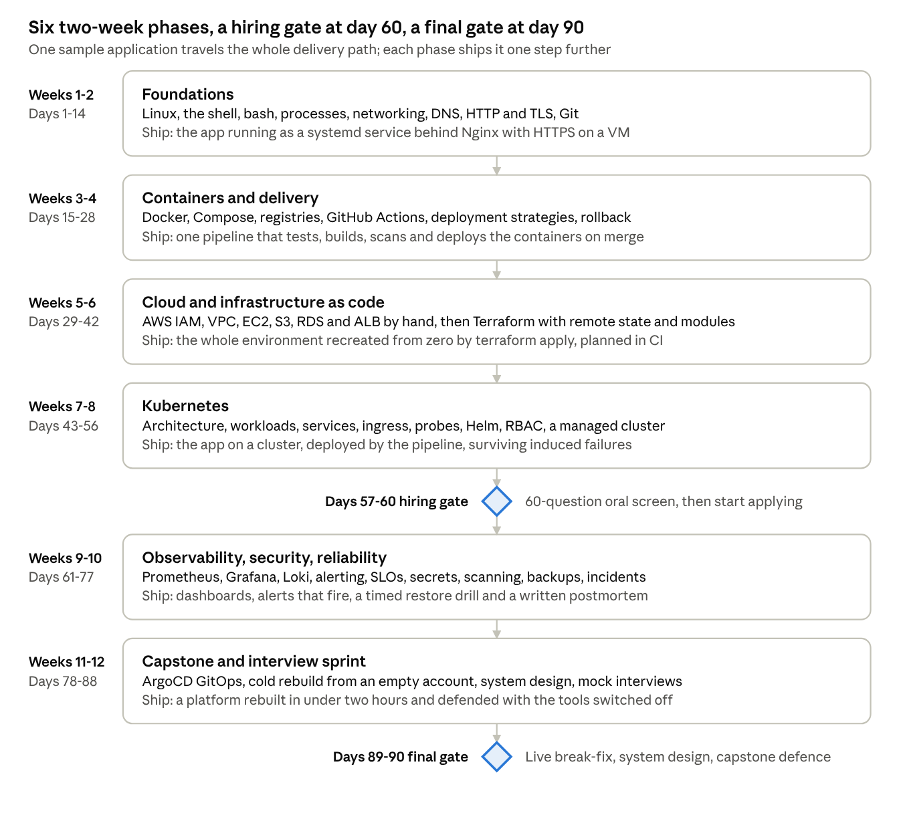

# Zero to DevOps: The 90 Day Fast Track

A curriculum that takes a complete beginner to an intermediate DevOps engineer in 90 days: able to pass a technical screen by day 60 and to build, run and defend a production platform by day 90.

Every topic is taught as what it is, why it exists and how it breaks, because that is what short interview questions test. One sample application (an API, a worker and Postgres) travels the whole delivery path: a server, a container, a pipeline, a cloud account, Terraform, a cluster, dashboards, secrets, GitOps.

- Full curriculum: [CURRICULUM.md](CURRICULUM.md)
- Living draft (comments and edits): https://claude.ai/artifact/Eh8kKJNmELS5QzNJLCi7P4
- Open decisions and next deliverables: [tasks/todo.md](tasks/todo.md)

## Structure

| Weeks | Phase | Ships |
| --- | --- | --- |
| 1 to 2 | Foundations: Linux, networking, DNS, TLS, Git | The app as a systemd service behind Nginx with HTTPS |
| 3 to 4 | Containers and delivery: Docker, Compose, GitHub Actions | One pipeline that tests, builds, scans and deploys on merge |
| 5 to 6 | Cloud and infrastructure as code: AWS, Terraform | The environment recreated from zero by terraform apply |
| 7 to 8 | Kubernetes, then the day-60 hiring gate | The app on a cluster, deployed by the pipeline |
| 9 to 10 | Observability, security, reliability | Dashboards, alerts that fire, a restore drill, a postmortem |
| 11 to 12 | GitOps capstone and interview sprint, then the final gate | A platform rebuilt from an empty account in under two hours |

Each week has a lessons table (what, why, how it breaks), a Friday project with done-when criteria and induced failures, and an eight-question interview drill with the points a strong answer names.
